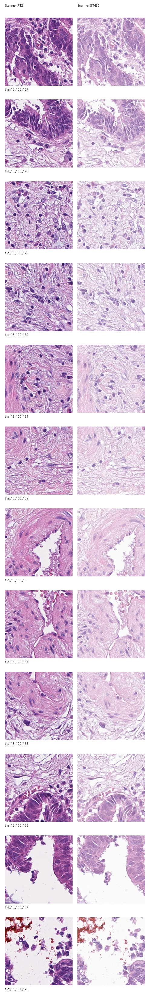
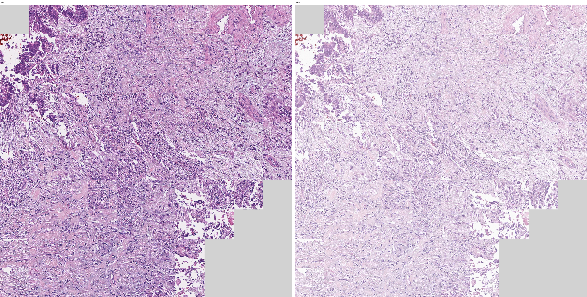

# PLISM Dataset Exploration

**Pilot study: Cross-Scanner Graph Topology Stability in Histopathology**

This directory contains the data preparation, inspection scripts, analysis outputs, and reproducible pilot experiments for studying how changes in whole-slide image (WSI) scanner appearance affect image features and graph connectivity. The pilot uses **corresponding tissue tiles from the PLISM dataset**, scanned with **AT2** and **GT450** under the **GIVH** staining condition.

> **Status:** Pilot dataset exploration completed (Steps 01–15). These are preliminary results from one selected tissue region, not a trained diagnostic classifier or a generalizable clinical evaluation.

## Overview

| Item | Pilot setup |
| --- | --- |
| Dataset | [PLISM tiles on Hugging Face](https://huggingface.co/datasets/owkin/plism-dataset-tiles) |
| Selected stainer | `GIVH` |
| Compared scanners | `AT2`, `GT450` |
| Matched tissue locations | **90** |
| Validated image files | **180** (90 per scanner) |
| Tile resolution | **224 × 224 px** |
| Selected tile grid | **10 × 10** coordinate window, **90%** observed coverage |
| Feature extractor | [`facebook/dinov2-small`](https://huggingface.co/facebook/dinov2-small), frozen |
| Feature dimension | **384** per tile |
| Graph variants | Spatial-only; cosine feature-kNN; spatially restricted hybrid |
| Pilot output | Initial comparison of image, embedding, and graph-edge consistency |

## Visual inspection

### Matched tile pairs

The same tile IDs were found in both scanner groups. The first comparison shows 12 corresponding tile pairs and their visible color/contrast differences.



### Reconstructed tissue region

A 10 × 10 coordinate window was assembled using tile IDs. **90 locations** were present in both groups; missing grid cells are displayed as gray placeholders. The paired mosaics preserve recognizable tissue structures, while GT450 generally appears paler and brighter.



> The mosaic is a visual quality check. Matching IDs and visual correspondence do not prove pixel-perfect registration. Tile coordinate semantics were inferred from identifier structure and should be verified against dataset documentation for larger studies.

## Main findings

### Image appearance

| Measure | Result |
| --- | ---: |
| Mean paired pixel absolute error (MAE), 0–255 scale | **47.6779** |
| Mean pixel brightness: AT2 | **179.8487** |
| Mean pixel brightness: GT450 | **216.6711** |
| Brightness-threshold tissue fraction: AT2 | **0.8768** |
| Brightness-threshold tissue fraction: GT450 | **0.6614** |

The tissue fractions are **heuristic estimates**, computed by treating pixels with all RGB channels above 220 as background. The paler GT450 appearance can bias this estimate. It is **not evidence** of an actual difference in tissue area.

### Paired DINOv2 embeddings

Both scanners were processed with the same frozen DINOv2-Small model and image preprocessing.

| Measure | Result |
| --- | ---: |
| Embedding matrices | `AT2: (90, 384)`; `GT450: (90, 384)` |
| Mean paired cosine similarity | **0.973113** |
| Minimum paired cosine similarity | **0.940725** |
| Maximum paired cosine similarity | **0.986593** |
| Mean paired Euclidean distance | **11.410014** |

High cosine similarity between corresponding tiles does **not** guarantee that their nearest-neighbor rankings or graph edges are identical.

### Cross-scanner graph stability

All graph variants used the **same 90 matched locations** and undirected edges.

| Graph construction | AT2 edges | GT450 edges | Shared edges | Edge Jaccard | Mean neighbor Jaccard | Connected components (AT2 / GT450) |
| --- | ---: | ---: | ---: | ---: | ---: | ---: |
| Spatial-only, 8-neighbor grid | 306 | 306 | 306 | **1.000000** | **1.000000** | 1 / 1 |
| Feature-kNN, cosine, `k=5` | 328 | 340 | 176 | **0.357724** | **0.379607** | 1 / 1 |
| Hybrid: up to `k=4` feature neighbors within the 8-neighbor grid | 231 | 238 | 208 | **0.796935** | **0.815357** | 1 / 1 |

**Interpretation:** Feature-based kNN selected substantially different edges for AT2 and GT450 in this pilot, despite high matched-patch cosine similarity. Restricting candidate neighbors to spatially local locations produced greater edge overlap under the chosen parameters. The spatial-only graph's perfect agreement is expected because its edges depend only on shared grid coordinates.

**Comparison limitation:** The feature-kNN and hybrid constructions use different candidate sets and values of `k`; the observed difference should not be attributed to spatial constraints alone until neighborhood budgets and other variables are controlled.

No pooling/coarsening model or diagnostic classifier was trained in this pilot.

## Directory structure

The following shows the intended project organization and primary output files. Not every generated file is listed.

```text
dataset_exploration/
├── README.md
├── scripts/
│   ├── 01_inspect_plism.py
│   ├── 02_analyze_plism_metadata.py
│   ├── 03_inspect_plism_files.py
│   ├── 04_inspect_plism_shards.py
│   ├── 05_find_scanner_pairs.py
│   ├── 06_verify_scanner_tile_ids.py
│   ├── 07_locate_matching_tiles.py
│   ├── 08_download_matched_tiles.py
│   ├── 09_visualize_scanner_pairs.py
│   ├── 10_identify_spatial_tile_region.py
│   ├── 11_download_spatial_region.py
│   ├── 12_validate_spatial_mosaic.py
│   ├── 13_extract_scanner_features.py
│   ├── 14_analyze_graph_topology.py
│   └── 15_generate_exploration_report.py
└── outputs/
    ├── figures/
    │   ├── plism_at2_gt450_comparison.png
    │   ├── plism_AT2_mosaic.png
    │   ├── plism_GT450_mosaic.png
    │   └── plism_spatial_mosaic_comparison.png
    ├── features/
    │   ├── plism_dinov2_features.npz
    │   └── plism_dinov2_pair_similarity.csv
    ├── tables/
    │   ├── plism_sample_metadata.csv
    │   ├── plism_remote_file_inventory.csv
    │   ├── plism_matched_tile_candidates.csv
    │   ├── plism_spatial_region_manifest.csv
    │   ├── plism_spatial_region_download_manifest.csv
    │   ├── plism_spatial_mosaic_metrics.csv
    │   ├── plism_graph_edges.csv
    │   └── plism_graph_stability.csv
    └── reports/
        ├── plism_spatial_mosaic_report.txt
        ├── plism_graph_stability.json
        └── PLISM_PILOT_FINAL_REPORT.md
```

The **image dataset** lives outside this folder at the project root:

```text
datasets/PLISM/GIVH_AT2_GT450/
├── AT2/    # downloaded tiles, named tile_<level>_<row>_<col>.png
└── GT450/  # matching tile names
```

## Workflow: Steps 01–15

| Step | Script | Purpose |
| --- | --- | --- |
| 01 | `01_inspect_plism.py` | Stream a small metadata sample and inspect dataset schema. |
| 02 | `02_analyze_plism_metadata.py` | Parse tile IDs and summarize sample scanner/slide metadata. |
| 03 | `03_inspect_plism_files.py` | List remote repository files; identify Parquet shards. |
| 04 | `04_inspect_plism_shards.py` | Sample metadata from separated shards. |
| 05 | `05_find_scanner_pairs.py` | Identify AT2 and GT450 under the same `GIVH` stainer. |
| 06 | `06_verify_scanner_tile_ids.py` | Test tile-ID overlap between initial scanner samples. |
| 07 | `07_locate_matching_tiles.py` | Locate 100 matching tile identifiers in the relevant scanner shards. |
| 08 | `08_download_matched_tiles.py` | Download and validate 20 initial matching image pairs. |
| 09 | `09_visualize_scanner_pairs.py` | Produce a side-by-side pair comparison and pixel statistics. |
| 10 | `10_identify_spatial_tile_region.py` | Locate 90 shared tile IDs in a target 10 × 10 window. |
| 11 | `11_download_spatial_region.py` | Reuse existing tiles and download/validate the remaining matched region. |
| 12 | `12_validate_spatial_mosaic.py` | Reconstruct mosaics and compute basic image statistics. |
| 13 | `13_extract_scanner_features.py` | Extract paired frozen DINOv2 embeddings. |
| 14 | `14_analyze_graph_topology.py` | Compare spatial, feature-kNN, and hybrid graph edge sets. |
| 15 | `15_generate_exploration_report.py` | Consolidate results in the final Markdown report. |

## Reproducing the pilot

Run from the **project root**, not from inside `dataset_exploration`:

```bash
cd ~/Medical_GNN_Research
source "$HOME/Unofficial Thesis/.venv-transformers/bin/activate"
```

The pilot environment includes Python, PyTorch, Transformers, Hugging Face Datasets, Pillow, NumPy, Pandas, scikit-learn, and tqdm. For shard inventory, it also uses `huggingface_hub`. Install only missing packages in your environment.

**If the image subset and manifests are already available**, the analysis can be reproduced with:

```bash
python dataset_exploration/scripts/12_validate_spatial_mosaic.py
python dataset_exploration/scripts/13_extract_scanner_features.py
python dataset_exploration/scripts/14_analyze_graph_topology.py
python dataset_exploration/scripts/15_generate_exploration_report.py
```

These steps use the local paired images and regenerate the pilot summary. Step 13 may retrieve DINOv2 weights from Hugging Face on the first run.

**For a fresh setup**, run scripts `01` through `15` in sequence. Steps involving PLISM access use Hugging Face streaming; they may transfer sizable remote Parquet data even when reading only a few rows. Do not download the entire PLISM collection merely to reproduce this pilot. The exact shards used for the selected region were `train-00000-of-00293.parquet` (AT2) and `train-00003-of-00293.parquet` (GT450).

### Core outputs

- [Final pilot exploration report](outputs/reports/PLISM_PILOT_FINAL_REPORT.md)
- [Graph stability table](outputs/tables/plism_graph_stability.csv)
- [Graph edge list](outputs/tables/plism_graph_edges.csv)
- [DINOv2 paired feature similarities](outputs/features/plism_dinov2_pair_similarity.csv)
- [Validated spatial download manifest](outputs/tables/plism_spatial_region_download_manifest.csv)
- [Full mosaic comparison](outputs/figures/plism_spatial_mosaic_comparison.png)

## Interpretation and limitations

This pilot demonstrates **edge-selection sensitivity** for feature-based graphs across two registered scanner conditions. It does **not** establish that scanner differences caused a diagnostic error, that graph coarsening collapsed, or that any one graph type is universally more robust.

Key limitations include a single tissue region; two scanner conditions under one stainer; a general-purpose, not pathology-specialized, image encoder; no measured registration error; no graph `k` sensitivity analysis; no coarsening stability analysis; no diagnostic labels or GNN training; and no statistical generalization assessment. Scanner-specific brightness may also bias simple background thresholds.

The findings should be cited as **pilot observations** until confirmed across independent tissue regions, different scanners, controlled graph hyperparameters, and diagnostic tasks.

## Next research phase

The completed pilot motivates a larger study of **cross-scanner graph topology stability for histopathology**. Phase 2 should specify hypotheses and protocols, expand to independent paired regions, compare graph construction methods at matched edge budgets, test pathology-specific feature extractors, quantify registration uncertainty, and separately investigate graph coarsening and labeled diagnostic evaluation.

## Dataset and attribution

- **PLISM dataset:** [Hugging Face dataset card](https://huggingface.co/datasets/owkin/plism-dataset-tiles)
- **Original PLISM collection:** [Figshare](https://plus.figshare.com/collections/Pathology_Images_of_Scanners_and_Mobilephones_PLISM_Dataset/6773925)
- **Feature extractor:** [DINOv2-Small](https://huggingface.co/facebook/dinov2-small)

Refer to the dataset card and model pages for the applicable licenses, terms of use, and required scholarly attribution. Dataset images are not redistributed by this README.
