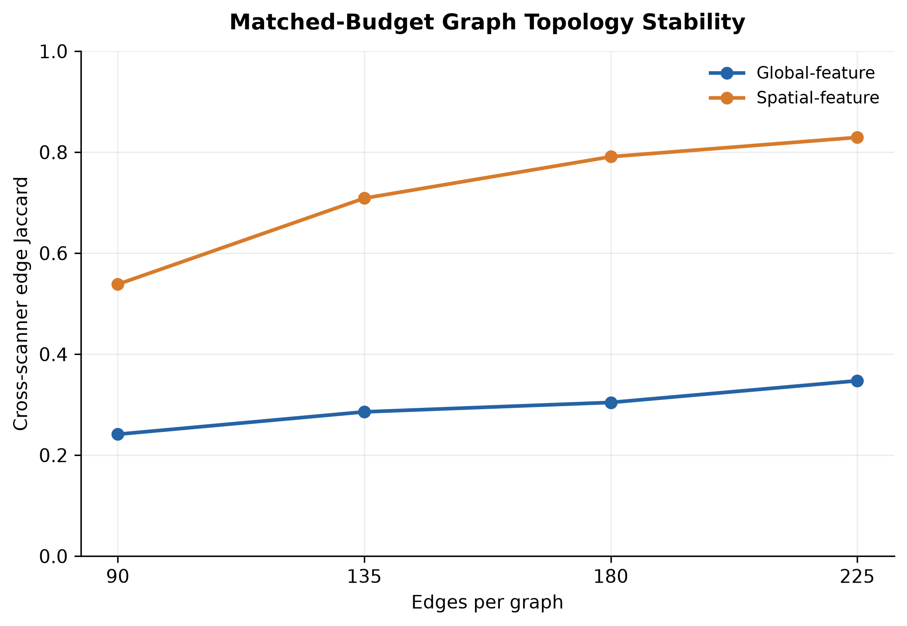
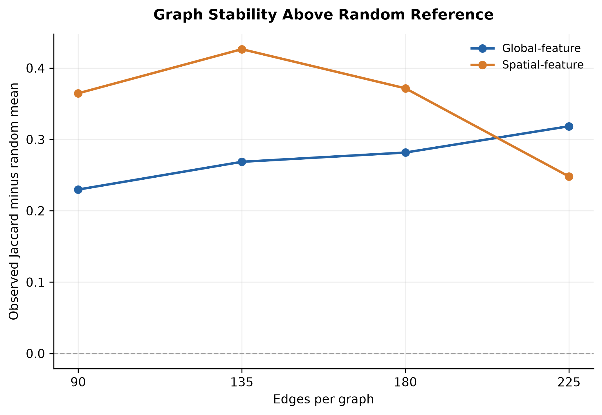
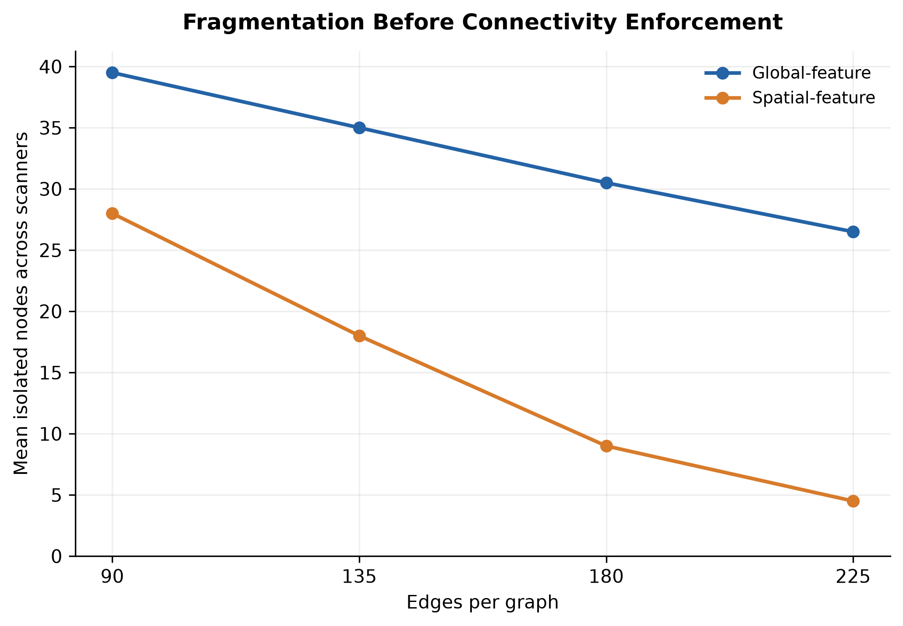
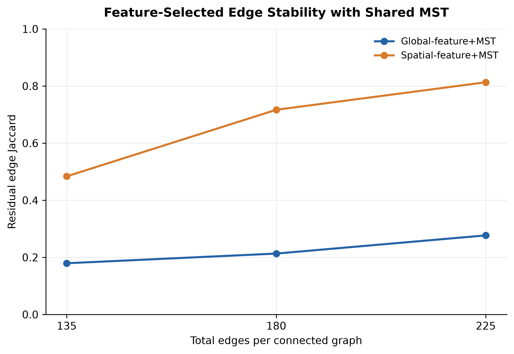
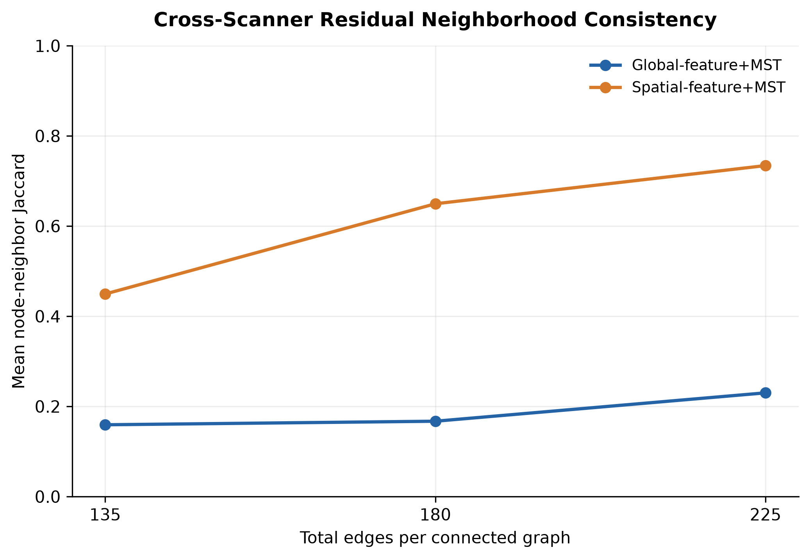
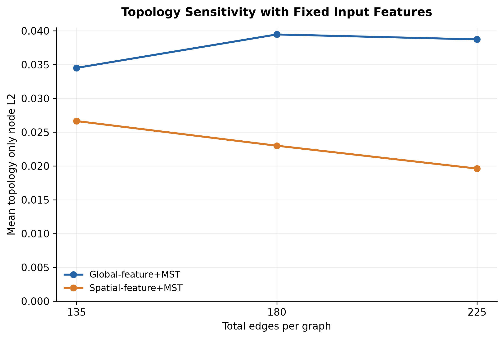
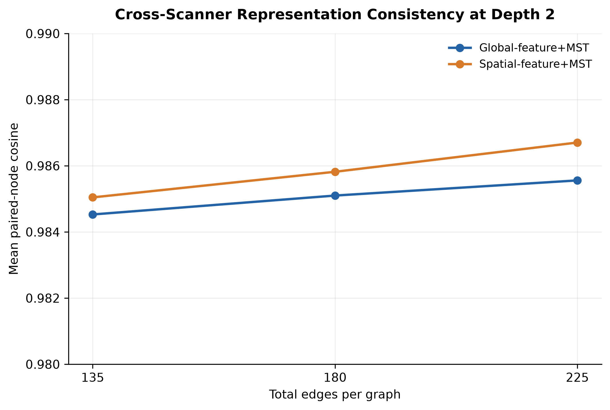
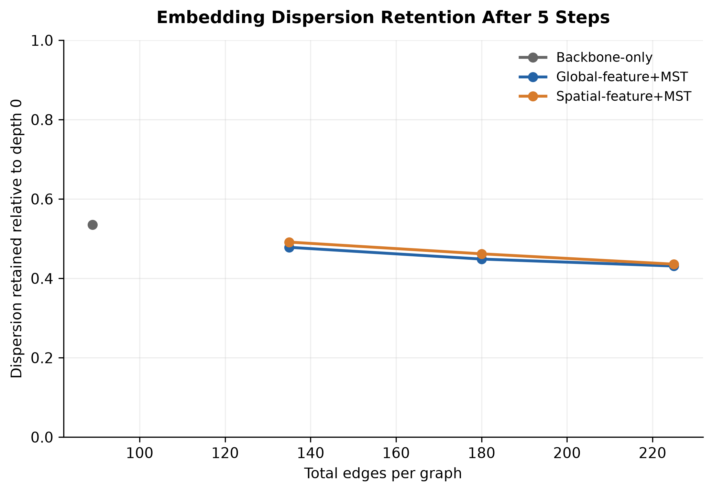

# Phase 3A: Cross-Scanner Graph Topology Stability

## Overview

This phase investigates how scanner-related image variation affects graph topology, neighborhood consistency, and graph representation stability in computational histopathology.

We conducted a pilot study using 90 matched histopathology tile locations from the PLISM dataset, captured using two scanners under the same staining condition.

The experiments focus on graph construction, structural robustness, connectivity, and representation smoothing.

**Research status:** Phase 3A pilot experiments completed.

## 1. Experimental Setup

| Component | Configuration |
|---|---|
| Dataset | PLISM (Owkin registered tiles) |
| Scanners | AT2 and GT450 |
| Staining condition | GIVH |
| Matched tile locations | 90 |
| Total tile images | 180 |
| Feature extractor | DINOv2-Small |
| Feature dimensionality | 384 |
| Graph methods | Global-feature and spatial-feature |
| Edge budgets | 90, 135, 180, 225 |
| Connected graph budgets | 135, 180, 225 |
| Connectivity backbone | 89-edge spatial MST |
| Propagation operator | Row-normalized adjacency with self-loops |
| Propagation depths | 0–5 |

## 2. Dataset and Annotation Verification

Official PLISM WSI annotation analysis produced the following results:

| Property | Result |
|---|---:|
| Total annotation records | 310,947 |
| Scanner/stain acquisition groups | 91 |
| GIVH AT2 coordinates | 3,417 |
| GIVH GT450 coordinates | 3,417 |
| Shared coordinates | 3,417 |
| Coordinate-level tissue-label agreement | 100% |
| Conflicting tissue labels | 0 |

The original PLISM annotations show complete coordinate-string and tissue-label agreement between the two scanner conditions.

However, a verified mapping between original WSI coordinates and Owkin registered tile coordinates has not been established. Biological specimen independence also remains unresolved.

## 3. Experimental Methodology

Phase 3A consists of the following experiments:

| Step | Experiment |
|---|---|
| 01–08 | Dataset feasibility, provenance, and annotation verification |
| 09 | Controlled edge-budget graph stability |
| 10 | Random-baseline and graph connectivity diagnostics |
| 11 | Connectivity-preserving graph construction |
| 12 | Structural and node-level stability diagnostics |
| 13 | Cross-scanner representation consistency |
| 14 | Oversmoothing and topology sensitivity |
| 15 | Final research figure generation |

The graph experiments compare two methods:

**Global-feature:** Selects edges using feature similarity across all available node pairs.

**Spatial-feature:** Selects feature-similar edges from spatially adjacent tile locations.

For connected graph experiments, both methods share the same fixed spatial minimum spanning tree. Scanner-dependent feature-selected edges are evaluated separately to avoid overstating stability.

---

# 4. Final Experimental Figures

All figures were generated from saved experimental results using `scripts/15_finalize_phase3a.py`.

Each figure is available in PNG and vector PDF format under `outputs/figures/`.

### Figure 1. Matched-Budget Graph Topology Stability



[View PDF](outputs/figures/figure_01_matched_budget_stability.pdf)

This figure compares cross-scanner edge Jaccard similarity between global-feature and spatial-feature graphs under identical edge budgets.

Spatial-feature graphs achieved greater raw edge agreement at all four budgets.

| Edge budget | Global-feature | Spatial-feature |
|---|---:|---:|
| 90 | 0.2414 | 0.5385 |
| 135 | 0.2857 | 0.7089 |
| 180 | 0.3043 | 0.7910 |
| 225 | 0.3473 | 0.8293 |

### Figure 2. Graph Stability Above Random Reference



[View PDF](outputs/figures/figure_02_chance_adjusted_stability.pdf)

This figure compares observed edge Jaccard with the mean from random edge selections within each method's eligible candidate pool.

Spatial-feature graphs showed higher excess agreement at budgets of 90, 135, and 180 edges. Global-feature graphs showed higher excess agreement at 225 edges.

These comparisons are descriptive and do not establish statistical significance.

### Figure 3. Graph Fragmentation



[View PDF](outputs/figures/figure_03_graph_fragmentation.pdf)

This figure illustrates isolated-node counts in the original top-M graph construction.

Both methods produced disconnected graphs, even at larger edge budgets.

Spatial-feature graphs generally had fewer isolated nodes, motivating the use of a connectivity-preserving spatial backbone.

### Figure 4. Connectivity-Preserving Residual Edge Stability



[View PDF](outputs/figures/figure_04_connected_residual_stability.pdf)

This figure compares residual feature-selected edges after excluding the 89-edge shared spatial spanning tree.

| Total budget | Global residual Jaccard | Spatial residual Jaccard |
|---|---:|---:|
| 135 | 0.1795 | 0.4839 |
| 180 | 0.2133 | 0.7170 |
| 225 | 0.2770 | 0.8133 |

All connected graph configurations contained one connected component and zero isolated nodes.

The spatial-feature method retained greater cross-scanner residual-edge agreement at every tested budget.

### Figure 5. Node-Level Neighborhood Stability



[View PDF](outputs/figures/figure_05_node_neighborhood_stability.pdf)

This figure measures residual neighbor-set consistency across corresponding nodes.

Nodes with empty residual neighborhoods in both scanners are excluded from the reported mean.

| Budget | Global-feature | Spatial-feature |
|---|---:|---:|
| 135 | 0.1593 | 0.4494 |
| 180 | 0.1672 | 0.6495 |
| 225 | 0.2301 | 0.7342 |

Spatial-feature graphs exhibited more consistent residual neighborhoods across the two scanners.

### Figure 6. Graph Topology Sensitivity



[View PDF](outputs/figures/figure_06_topology_sensitivity.pdf)

This figure measures representation changes caused by replacing scanner-specific graph connections while keeping node features fixed.

The comparison uses two propagation steps.

| Budget | Global topology L2 | Spatial topology L2 |
|---|---:|---:|
| 135 | 0.034518 | 0.026647 |
| 180 | 0.039463 | 0.022999 |
| 225 | 0.038728 | 0.019616 |

The spatial-feature method showed smaller topology-only representation differences at every matched budget.

### Figure 7. Cross-Scanner Representation Consistency



[View PDF](outputs/figures/figure_07_representation_consistency.pdf)

This figure compares corresponding node representations after two deterministic graph propagation steps.

| Method | Budget | Mean node cosine |
|---|---:|---:|
| Global-feature + MST | 135 | 0.984529 |
| Spatial-feature + MST | 135 | 0.985045 |
| Global-feature + MST | 180 | 0.985101 |
| Spatial-feature + MST | 180 | 0.985820 |
| Global-feature + MST | 225 | 0.985559 |
| Spatial-feature + MST | 225 | 0.986704 |
| Backbone-only | 89 | 0.984597 |

Spatial-feature graphs produced slightly greater cross-scanner representation similarity at equal budgets.

The differences are small, and increased similarity alone does not establish better downstream predictive performance.

### Figure 8. Oversmoothing and Embedding Dispersion Retention



[View PDF](outputs/figures/figure_08_oversmoothing_dispersion.pdf)

This figure shows the proportion of original embedding dispersion retained after five propagation steps.

| Graph | AT2 retention | GT450 retention |
|---|---:|---:|
| Global + MST, 225 edges | 0.4437 | 0.4184 |
| Spatial + MST, 225 edges | 0.4364 | 0.4352 |
| Backbone-only | 0.5386 | 0.5326 |

Repeated feature propagation increased cross-scanner similarity while reducing within-graph embedding dispersion.

This behavior is consistent with oversmoothing and motivates examining information preservation in subsequent experiments.

---

## 5. Main Research Findings

The Phase 3A pilot produced five main observations.

1. **Scanner-dependent graph instability:** Feature-based graph connections differed between matched AT2 and GT450 image representations.

2. **Improved spatial edge agreement:** Spatial restrictions increased cross-scanner edge agreement under controlled edge budgets in this selected region.

3. **Connectivity preservation:** A shared 89-edge spatial MST eliminated isolated nodes and disconnected components.

4. **Reduced topology sensitivity:** Spatial-feature graphs exhibited smaller representation changes when scanner-specific edges were exchanged.

5. **Representation smoothing:** Increased propagation depth produced more similar cross-scanner representations but reduced the distinctiveness of node embeddings.

These findings support further investigation of spatially constrained graph construction in scanner-variable computational histopathology.

## 6. Research Limitations

- Experiments used only one selected region containing 90 matched tile locations.
- Independent biological specimens have not been verified.
- Original WSI annotation coordinates have not been mapped to the registered Owkin tile coordinate system.
- Global and spatial methods have different eligible candidate-edge pools.
- Shared backbone edges increase full-graph stability by construction.
- Representation propagation was deterministic and did not involve trained GNN weights.
- Graph coarsening, pooling, and downstream prediction remain untested.
- Results do not establish generalization across independent specimens.

## 7. Repository Structure

```text
experimental_research/
├── README.md
├── Docs/
├── scripts/
│   ├── 01_audit_plism_feasibility.py
│   ├── ...
│   ├── 14_oversmoothing_topology_sensitivity.py
│   └── 15_finalize_phase3a.py
└── outputs/
    ├── tables/
    ├── reports/
    └── figures/
        ├── figure_01_matched_budget_stability.png
        ├── figure_02_chance_adjusted_stability.png
        ├── figure_03_graph_fragmentation.png
        ├── figure_04_connected_residual_stability.png
        ├── figure_05_node_neighborhood_stability.png
        ├── figure_06_topology_sensitivity.png
        ├── figure_07_representation_consistency.png
        ├── figure_08_oversmoothing_dispersion.png
        ├── corresponding PDF versions
        └── FIGURE_INVENTORY.csv
```

## 8. Reproducibility

Activate the research environment:

```bash
cd ~/MEDICAL_GNN_RESEARCH

source "$HOME/Unofficial Thesis/.venv-transformers/bin/activate"
```

Regenerate the final figures and Phase 2/3A README templates:

```bash
python -u experimental_research/scripts/15_finalize_phase3a.py
```

**Important:** Script 15 overwrites the Phase 3A README with its original generated template. Back up this expanded README before rerunning Script 15.

The experimental results are stored in:

- `outputs/tables/`: Graph stability, structural diagnostics, node-level metrics, and representation results.
- `outputs/reports/`: Machine-readable experiment reports.
- `outputs/figures/`: Final PNG/PDF research figures.

## 9. Next Phase: Multi-Region Research

The next stage is **Phase 3B: Multi-Region Controlled Experiments**, maintained separately in:

`../multi_region_research/`

The objectives are to:

1. Identify multiple spatially separated paired histopathology regions.
2. Verify tissue provenance and prevent overlapping evaluation regions.
3. Incorporate pathology-specific feature encoders.
4. Replicate controlled graph comparisons.
5. Examine graph coarsening and representation stability.
6. Evaluate variability across defensible independent analysis units.

## 10. References

1. [PLISM Dataset Publication](https://doi.org/10.1038/s41597-024-03122-5)
2. [Owkin PLISM Registered Tile Dataset](https://huggingface.co/datasets/owkin/plism-dataset-tiles)

## Conclusion

Phase 3A establishes a reproducible pilot baseline for studying graph topology stability across scanner-acquired histopathology images.

The results indicate that spatially constrained feature-based graphs can provide more consistent connections and lower topology-induced representation variation under the evaluated conditions.

Broader multi-region experiments, verified specimen provenance, graph coarsening analysis, and downstream evaluation are necessary before making stronger research claims.
