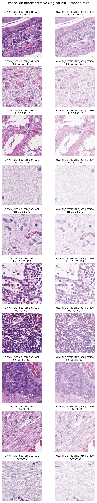
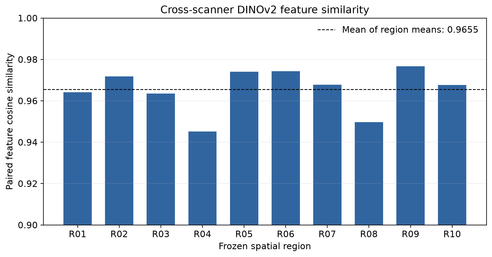
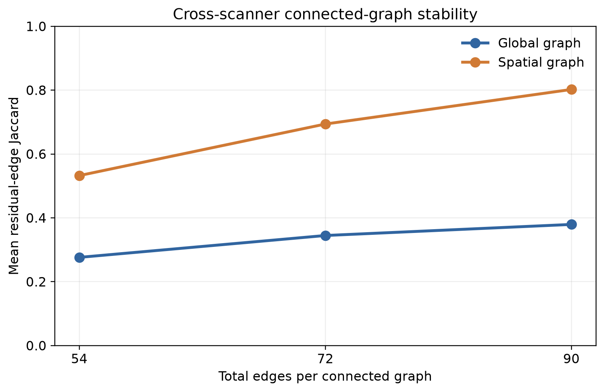
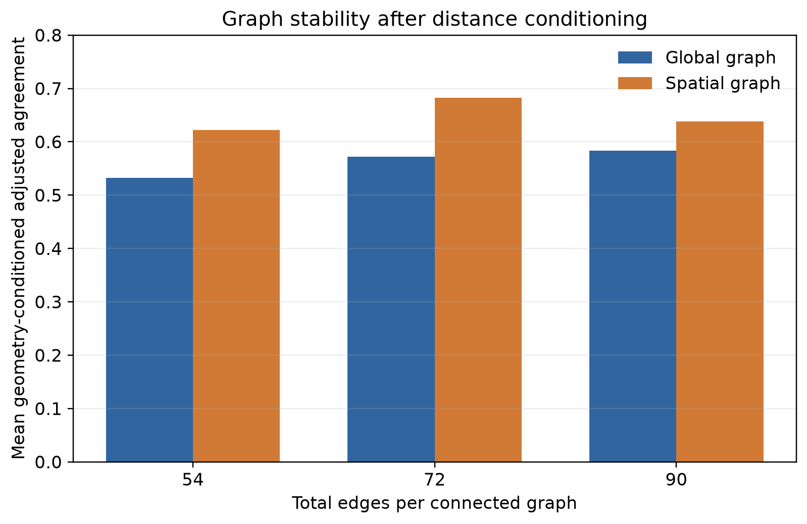
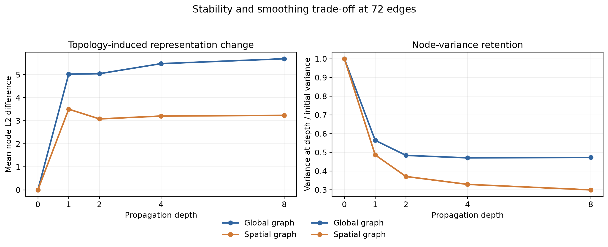
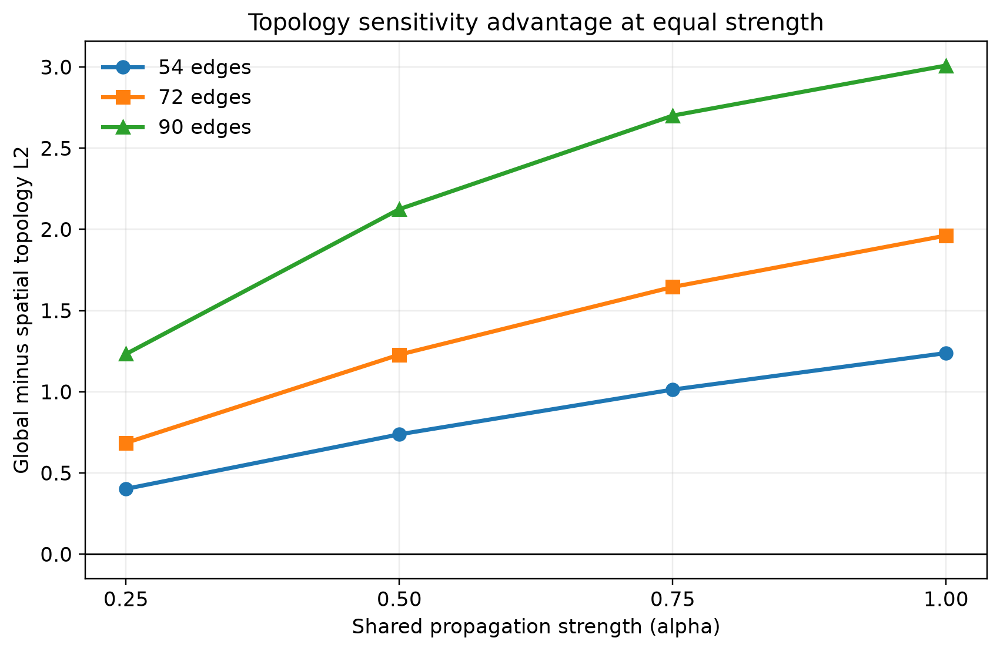

# Cross-Scanner Graph Topology Stability in Digital Histopathology

**Phase 3B: Multi-Region Experimental Research**

**Status:** Completed and frozen  
**Dataset:** Owkin PLISM  
**Image acquisitions:** GIVH AT2 and GT450  
**Feature encoder:** DINOv2-Small  
**Research stage:** Completed preliminary validation, preparing for main graph-learning research

## 1. Overview

This research investigates how scanner-dependent variation in digital histopathology images affects graph topology construction and graph-based representation consistency.

Histopathology graph neural networks commonly represent image patches as nodes and construct edges using spatial relationships or learned feature similarity. Even when corresponding tissue locations are available across scanners, differences in image appearance can influence the extracted features and consequently alter feature-selected graph edges.

We investigate three central questions:

1. How stable are feature-selected graph connections between registered scanner acquisitions?
2. Can spatial constraints improve graph topology and propagated representation consistency?
3. What trade-offs arise between graph stability, geometric restrictions, and representation smoothing?

The completed Phase 3B experiments evaluate these questions across ten frozen spatial regions using original image data, matched graph budgets, connectivity controls, geometry-conditioned null models, and deterministic graph propagation.

**The findings establish an experimental basis for future stability-aware graph learning. They do not demonstrate improved diagnostic accuracy or independent biological generalization.**

---

## 2. Dataset and Experimental Cohort

### 2.1 Dataset

The research uses original histopathology tile images from the [Owkin PLISM dataset](https://huggingface.co/datasets/owkin/plism-dataset-tiles).

The experiments focus on two registered acquisitions associated with the GIVH specimen:

- AT2 acquisition: `GIVH_AT2_to_GMH_S60`
- GT450 acquisition: `GIVH_GT450_to_GMH_S60`

Images were recovered from the original Parquet data using HTTP byte-range retrieval. Dataset Viewer JPEG previews were excluded from primary experiments because earlier validation demonstrated they were not pixel-equivalent to the original PNGs.

### 2.2 Frozen study cohort

| Property | Value |
|---|---:|
| Spatial regions | 10 |
| Tile positions per region | 36 |
| Grid geometry | 6 × 6 |
| Matched positions | 360 |
| Scanner acquisitions per position | 2 |
| Original PNG images | 720 |
| Image resolution | 224 × 224 |
| Graph nodes per region | 36 |
| Independent biological specimens verified | No |

The ten regions were selected from distributed spatial sampling bands within the available registered tile coordinates.

They are spatially separated but are **not verified independent patients, specimens, or tissue slides**.

### 2.3 Frozen manifest

`outputs/validated/phase3b_frozen_tile_manifest.csv`

SHA256:

`69d11e1a0dd1107f2e6534632727e2c2291ff83d6b17cf953ed5056bea9020f9`

The sampling manifest remained unchanged throughout the Phase 3B experiments.

### 2.4 Representative scanner-paired images

*Figure 1. Representative original PNG tile pairs from the frozen ten-region cohort. Corresponding tile identifiers refer to registered acquisition locations. Visual inspection is illustrative and does not independently establish registration accuracy.*

---

## 3. Feature Extraction

We reproduced the original Phase 1 DINOv2 feature-extraction protocol.

| Component | Configuration |
|---|---|
| Model | `facebook/dinov2-small` |
| Framework | Hugging Face Transformers / PyTorch |
| Input format | RGB-converted original PNG |
| Processor | Pretrained `AutoImageProcessor` |
| Batch size | 8 |
| Embedding | CLS token from `last_hidden_state[:, 0, :]` |
| Feature dimensions | 384 |
| Stored feature dtype | `float32` |
| Stored feature normalization | None |
| Graph similarity | Cosine similarity using L2-normalized features |

The resulting feature archive contains:

- `at2`: `(360, 384)`
- `gt450`: `(360, 384)`
- `tile_ids`: `(360,)`
- `grid_rows`: `(360,)`
- `grid_cols`: `(360,)`
- `region_ids`: `(360,)`

The original, unnormalized CLS embeddings were preserved for all downstream graph experiments.

### 3.1 Cross-scanner feature similarity

The overall mean paired cosine similarity was **0.965486**, with a mean Euclidean feature distance of **12.830521**.

The ten region-level mean cosine similarities ranged from **0.945178** in Region 004 to **0.976666** in Region 009.

*Figure 2. Mean DINOv2 paired cosine similarity for the ten frozen regions.*

These results indicate that corresponding scanner acquisitions produce closely related, but nonidentical, DINOv2 embeddings. The degree of similarity varies by region.

---

## 4. Graph Construction Protocol

Each region was analyzed as an independent 36-node graph construction problem. Regions were not combined into a single 360-node graph.

Two primary graph-construction approaches were evaluated.

### 4.1 Global feature-similarity graphs

Candidate edges may connect any two distinct nodes in a region.

For 36 nodes, the unrestricted candidate pool contains:

\[
\binom{36}{2}=630
\]

Edges are selected in descending order of cosine similarity between DINOv2 embeddings.

### 4.2 Spatially constrained feature graphs

Candidate edges are limited to immediate neighboring grid positions, including diagonal neighbors.

Each full 6 × 6 grid contains **110 possible undirected eight-neighbor edges**.

Within this candidate pool, edges are again ranked using DINOv2 cosine similarity.

### 4.3 Connectivity-preserving graphs

For the connected-graph experiments, both methods share a deterministic **35-edge spatial minimum spanning tree** constructed from grid coordinates.

The remaining edges are selected using scanner-specific features.

The connected experiments use three total edge budgets:

| Total graph edges | Common spanning-tree edges | Residual selected edges |
|---|---:|---:|
| 54 | 35 | 19 |
| 72 | 35 | 37 |
| 90 | 35 | 55 |

Every constructed connected graph was validated to contain one connected component and zero isolated nodes.

The shared backbone raises raw full-edge agreement, so the primary topology comparisons focus on **residual edges**, excluding the common tree.

---

## 5. Experimental Results

### 5.1 Unconstrained Top-M graph stability

**Step 3B.20**

The initial multi-region comparison used four matched edge budgets: 36, 54, 72, and 90 edges.

| Edge budget | Global edge Jaccard | Spatial edge Jaccard |
|---|---:|---:|
| 36 | 0.3670 | 0.5585 |
| 54 | 0.3674 | 0.6843 |
| 72 | 0.4171 | 0.7740 |
| 90 | 0.4456 | 0.8720 |

Spatially constrained graphs produced higher mean cross-scanner edge overlap across all four budgets.

However, unconstrained Top-M selection created disconnected graphs, particularly for the global method. This motivated the connectivity-preserving analysis.

### 5.2 Connectivity-controlled residual edge stability

**Step 3B.21**

After applying the identical spatial spanning tree to both methods:

| Total edges | Global residual Jaccard | Spatial residual Jaccard | Difference |
|---|---:|---:|---:|
| 54 | 0.2761 | 0.5323 | +0.2562 |
| 72 | 0.3446 | 0.6938 | +0.3492 |
| 90 | 0.3793 | 0.8021 | +0.4228 |

*Figure 3. Cross-scanner residual-edge Jaccard at matched graph sizes with a shared connectivity-preserving spanning tree.*

The spatial construction retained a substantial residual-edge overlap advantage. At 72 and 90 edges, every selected region favored the spatial graph under raw residual Jaccard.

These values should not be interpreted without accounting for the unequal candidate-pool sizes.

### 5.3 Node-neighborhood stability

**Step 3B.22**

We examined residual graph neighborhoods at the individual node level.

| Edge budget | Global node Jaccard | Spatial node Jaccard | Regions favoring spatial |
|---|---:|---:|---:|
| 54 | 0.2254 | 0.4971 | 10/10 |
| 72 | 0.2837 | 0.6544 | 10/10 |
| 90 | 0.2879 | 0.7774 | 10/10 |

Nodes whose residual neighborhoods were empty under both scanners were excluded from the primary node-Jaccard average and counted separately.

Global graphs also contained more long-range residual connections. Spatial residual edges were local by definition.

The results demonstrate greater neighborhood consistency for spatial graphs within this experimental protocol.

### 5.4 Geometry-conditioned graph stability

**Step 3B.25**

To evaluate the influence of geometric restrictions, we introduced an exact conditional null model.

The model preserves each scanner's counts of residual edges within strata defined by squared grid distance, while randomly selecting candidate edges within those strata.

| Edge budget | Global adjusted agreement | Spatial adjusted agreement | Spatial-positive regions |
|---|---:|---:|---:|
| 54 | 0.5322 | 0.6226 | 7/10 |
| 72 | 0.5721 | 0.6829 | 7/10 |
| 90 | 0.5833 | 0.6385 | 6/10 |

*Figure 4. Conditional adjusted agreement after controlling for residual candidate pools and scanner-specific squared-distance distributions.*

The spatial method maintained higher mean conditional adjusted agreement, but the advantage decreased and was no longer consistent in every region.

Both graph types exceeded their geometry-conditioned random-overlap expectations across all tested region-budget configurations.

**Interpretation:** Candidate-pool restrictions and edge geometry contribute to observed graph stability. The spatial method does not universally dominate the global approach under stronger geometric controls.

---

## 6. Graph Propagation and Representation Consistency

**Steps 3B.23–3B.24**

To test how graph changes affect node representations, we used deterministic symmetric normalized adjacency propagation:

\[
H^{(k)}=S^kX
\]

where

\[
S=D^{-1/2}(A+I)D^{-1/2}
\]

and \(X\) contains raw DINOv2 CLS embeddings.

The graph includes self-loops through \(A+I\).

Four crossed feature/graph conditions were evaluated so that feature changes and graph-topology changes could be examined separately.

### 6.1 Topology-only sensitivity

At depth 2:

| Edge budget | Global topology L2 | Spatial topology L2 | Relative reduction |
|---|---:|---:|---:|
| 54 | 4.3704 | 3.1321 | 28.3% |
| 72 | 5.0385 | 3.0766 | 38.9% |
| 90 | 5.5695 | 2.5607 | 54.0% |

Lower topology-only L2 means that swapping between the scanner-specific graph structures produced smaller changes when the input features were held fixed.

The spatial method showed smaller mean topology-only differences at every budget.

### 6.2 Oversmoothing and node-variance retention

We quantified retained node variance using:

\[
R_k=\frac{V_k}{V_0}
\]

where \(V_k\) is the variance of node representations at propagation depth \(k\).

At depth 2:

| Edge budget | Global variance retention | Spatial variance retention |
|---|---:|---:|
| 54 | 43.99% | 39.42% |
| 72 | 48.39% | 37.12% |
| 90 | 51.60% | 31.49% |

*Figure 5. Topology-induced representation differences and node-variance retention at the 72-edge graph budget.*

Spatial graphs produced smaller topology-induced changes while also showing greater reduction in variance among node embeddings.

Lower variance retention may indicate stronger smoothing. It does not establish that clinically useful information has been lost.

**This stability-versus-smoothing trade-off is one of the main findings of the completed phase.**

---

## 7. Propagation Control Experiments

### 7.1 Variance-matched propagation

**Step 3B.26**

We calibrated the spatial propagation strength to approximately match the global graph's average AT2/GT450 variance retention.

The adjusted operator was:

\[
S_{\alpha}=(1-\alpha)I+\alpha S
\]

At depth 2:

| Edges | Global topology L2 | Calibrated spatial topology L2 | Mean spatial α |
|---|---:|---:|---:|
| 54 | 4.3704 | 2.8033 | 0.6983 |
| 72 | 5.0385 | 2.2559 | 0.4521 |
| 90 | 5.5695 | 1.5165 | 0.3155 |

All 30 variance-retention calibrations met the specified error tolerance.

The calibrated spatial method retained lower mean topology sensitivity. However, the calibration also reduced its propagation strength.

This is an exploratory within-region calibration control, not an independently validated learned method.

### 7.2 Equal-strength propagation

**Step 3B.27**

To control propagation strength directly, we evaluated both graph methods using the same values of α: 0.25, 0.50, 0.75, and 1.00.

At 72 edges:

| α | Global topology L2 | Spatial topology L2 | Regions favoring spatial |
|---|---:|---:|---:|
| 0.25 | 2.1693 | 1.4840 | 10/10 |
| 0.50 | 3.6811 | 2.4526 | 10/10 |
| 0.75 | 4.5955 | 2.9503 | 10/10 |
| 1.00 | 5.0385 | 3.0766 | 10/10 |

*Figure 6. Mean global-minus-spatial topology-only L2 advantage using identical propagation strength, depth, and graph budget.*

At the reference configuration of 72 edges, depth 2, and α = 0.50:

- Global mean topology-only L2: **3.681058**
- Spatial mean topology-only L2: **2.452613**
- Relative reduction: **33.37%**
- Spatial-positive regions: **10/10**

Spatial graphs still retained less node variance at equal α, so this experiment should be interpreted alongside the oversmoothing results.

---

## 8. Consolidated Experimental Evidence

| Experiment | Principal observation |
|---|---|
| 3B.19 | Scanner-paired DINOv2 embeddings are similar but nonidentical |
| 3B.20 | Spatial graphs show greater raw edge-set stability |
| 3B.21 | Spatial residual-edge stability advantage persists after enforcing connectivity |
| 3B.22 | Spatial graphs have more consistent residual neighborhoods |
| 3B.23 | Spatial graphs exhibit smaller topology-induced propagation changes |
| 3B.24 | Spatial propagation produces greater node-variance reduction |
| 3B.25 | Geometry-conditioned adjustment reduces the consistency of the spatial advantage |
| 3B.26 | Spatial graphs maintain lower topology sensitivity under variance-matched calibration |
| 3B.27 | Spatial graphs maintain lower topology sensitivity under identical propagation strengths |
| 3B.28 | Research evidence consolidated and Phase 3B formally closed |

### Main research finding

Across the selected PLISM regions, spatially constrained graph construction generally improved observed cross-scanner graph topology and deterministic representation consistency.

However, stronger spatial restrictions also changed the candidate-edge structure and increased representation smoothing. Geometry-conditioned results showed that the stability advantage was not universal.

These observations motivate investigating graph-learning approaches that balance **cross-scanner consistency, geometric structure, and preservation of distinct node representations**.

---

## 9. Experimental Limitations

This research has several important limitations.

**Biological independence:** The ten selected regions originate from one registered acquisition pair. They must not be interpreted as independent patients or specimens.

**Scanner variation:** The observed differences are between two specific registered acquisitions. Other preparation, acquisition, or processing differences cannot be ruled out as contributing factors.

**Registration quality:** Exact tile identifiers and image pairing were verified, but manual registration quality assessment has not been completed.

**Encoder choice:** DINOv2-Small is a general-purpose visual encoder rather than a pathology-specific feature model.

**Graph restrictions:** Global and spatial graph construction methods use different candidate-edge pools. Raw overlap comparisons do not isolate the effects of geometric restrictions.

**Smoothing:** Reduced topology sensitivity may coexist with reduced node diversity. Smaller representation differences do not necessarily imply improved downstream utility.

**Downstream evaluation:** No trained GNN, classification accuracy, clinical labels, or externally validated diagnostic task was evaluated in Phase 3B.

**Generalizability and novelty:** Independent biological replication and a dedicated comparison with recent related literature are required before strong generalization or novelty claims.

---

## 10. Reproducibility and Repository Structure

The repository retains the Phase 3B scripts, frozen manifest, feature archive,