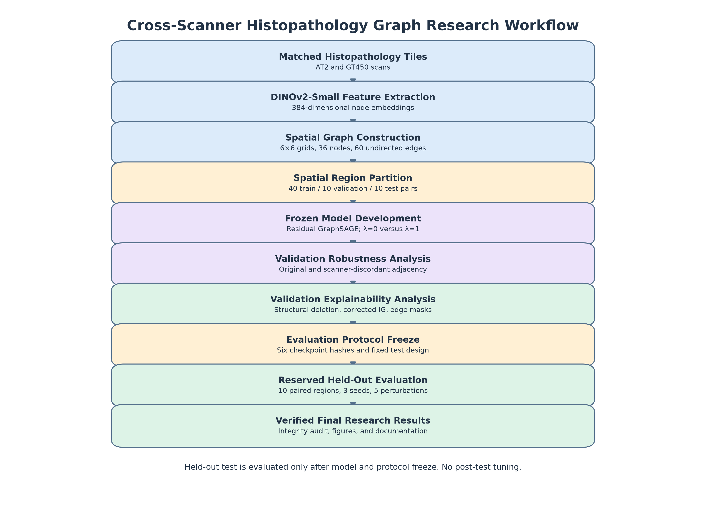
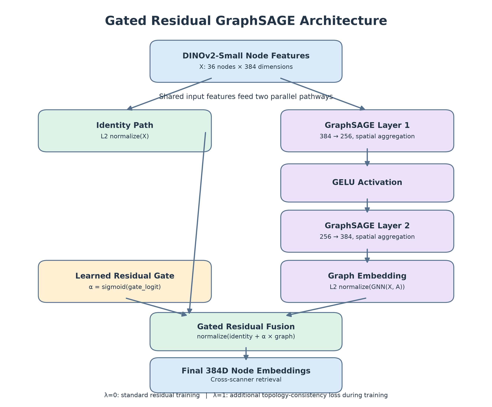
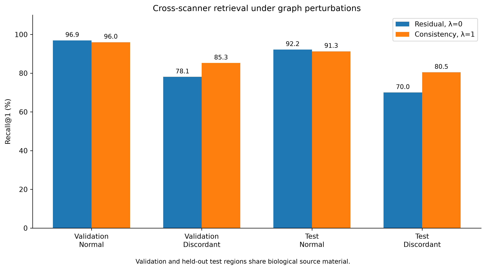
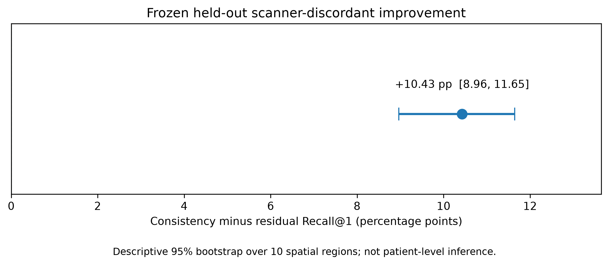
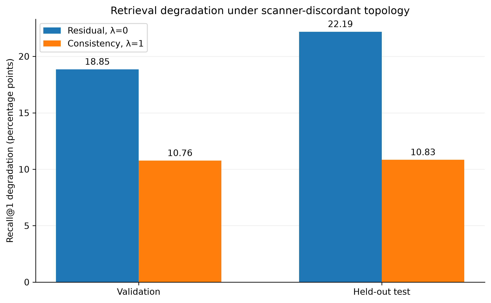
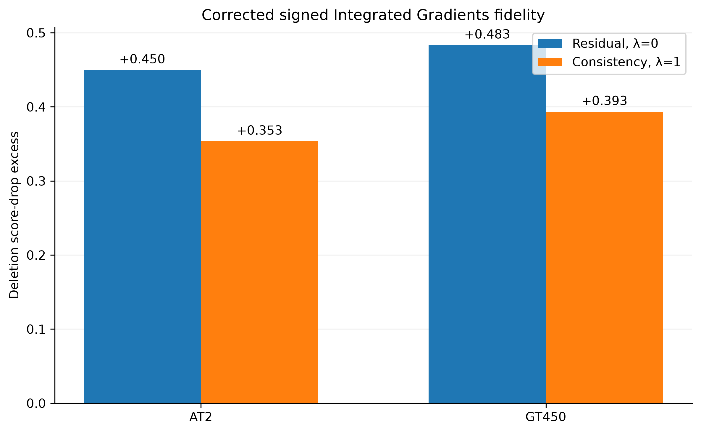
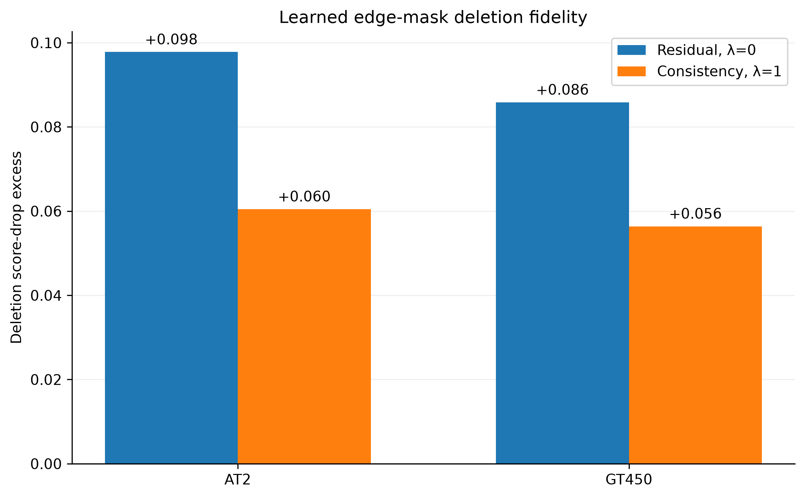
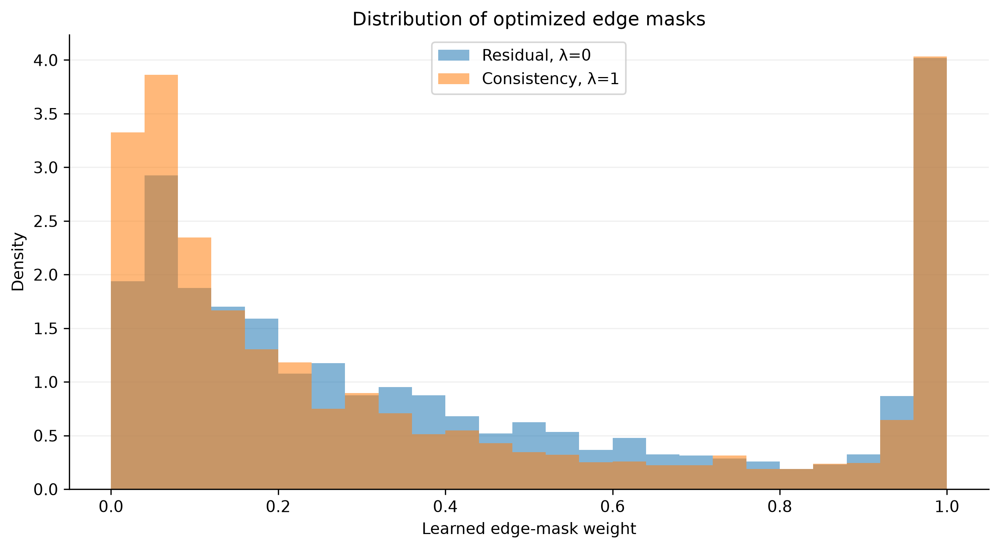

# Phase 4: Stability-Aware and Explainable Graph Neural Networks for Cross-Scanner Histopathology Representation Learning

> **Research status:** Phase 4 experiments, frozen held-out evaluation, and result-integrity audits completed. The models and test protocol are frozen; no further test-driven tuning is permitted.
>
> **Scope:** Matched-tile representation retrieval between AT2 and GT450 scans of shared tissue, using synthetic scanner-discordant **graph-topology** perturbations. These experiments do **not** establish robustness to new patients, independent slides, or real-world scanner domain shifts.

## Overview

This phase investigates whether topology-consistency regularization makes graph neural network (GNN) representations less sensitive to disagreement between the neighborhood structures supplied to matched cross-scanner histopathology images. We compare a gated residual GraphSAGE model trained without topology regularization (**ResidualGate05**, λ = 0) against the same architecture with a topology-consistency term (**TopologyConsistentResidual**, λ = 1).

We also study how topology changes influence the learned representations and three complementary forms of explanation: structural node perturbations, corrected Integrated Gradients (IG), and optimized edge masks. All model development and exploratory explainability analysis precede the frozen held-out evaluation.

**Principal held-out result:** topology-consistent training improved scanner-discordant AT2→GT450 matched-tile **Recall@1 by +10.4259 percentage points**, with a descriptive 95% region-cluster bootstrap interval of **[+8.9630, +11.6481] pp**. The direction of the paired difference was positive in **10 of 10** reserved spatial region pairs.

### Main contributions

- A controlled cross-scanner matched-region graph-retrieval setup using frozen DINOv2-Small features and spatial 6×6 tile grids.
- A direct comparison of gated residual GraphSAGE with and without topology-consistency training under identical seeds and frozen checkpoint selection.
- Deterministic scanner-discordant adjacency interventions that leave node features and node correspondences unchanged.
- Separate analysis of retrieval robustness, representation behavior, and explanation agreement/fidelity.
- A predeclared, hashed evaluation protocol, checkpoint verification, held-out test, and independent read-only audit of every saved test observation.

## 1. Dataset and experimental unit

| Property | Specification |
|---|---|
| Source | Owkin PLISM, pinned revision `489cfa632886ce411ce0ab6e678e0587ac0ead04` |
| Tissue | GIVH tissue condition, one shared biological source/specimen context |
| Scanner views | AT2 and GT450 |
| Spatial unit | Matched 6×6 tile region from each scanner |
| Graphs | 120 scanner-specific graphs, arranged as 60 matched region pairs |
| Nodes per graph | 36 tiles, with tile-ID correspondence between scanners |
| Edges | Four-neighbor spatial grid; 60 undirected edges, stored as 120 directed edges |
| Feature extractor | Frozen pretrained DINOv2-Small (`facebook/dinov2-small`) |
| Node representation | 384-dimensional CLS embedding |
| Train / validation / held-out test | 40 / 10 / 10 matched region pairs (80 / 20 / 20 graphs) |
| Spatial splitting | Region separation with at least a two-tile gap |

The split is performed at the **spatial-region level**, not at the patient level. The ten held-out pairs are different spatial locations from the same overall biological source context. Tile retrieval is used as a representation-matching proxy task, **not** as a clinical classification or diagnosis task.

**Dataset exploration figures** (early quality-control material; not post-freeze model evaluations):

| Contact sheets | Scanner-pair diagnostics |
|---|---|
| [Train contact sheet](outputs/figures/11_train_at2_gt450_contact_sheet.png) | [Train pair diagnostics](outputs/figures/12_train_worst_scanner_pairs.png) |
| [Validation contact sheet](outputs/figures/11_validation_at2_gt450_contact_sheet.png) | [Validation pair diagnostics](outputs/figures/12_validation_worst_scanner_pairs.png) |
| [Reserved-region contact sheet](outputs/figures/11_test_at2_gt450_contact_sheet.png) | [Reserved-region pair diagnostics](outputs/figures/12_test_worst_scanner_pairs.png) |

The presence of early filenames containing `test` reflects exploratory dataset visualization; it must not be confused with the later one-time model evaluation under the frozen protocol. The held-out model inference occurred only in Phase 4.4.1.

## 2. Research workflow



[Scalable SVG workflow](outputs/figures/51_complete_research_workflow.svg)

1. Inspect matched scanner tiles and data integrity; construct spatially separated matched region pairs.
2. Extract frozen 384D DINOv2 embeddings for corresponding AT2 and GT450 tiles.
3. Construct 36-node four-neighbor graph representations for each scanner view.
4. Establish non-graph and graph baselines; examine adjacency controls.
5. Train gated residual GraphSAGE models for the same three seeds, with λ = 0 or λ = 1.
6. Conduct exploratory validation retrieval, topology perturbation, representation-preservation, and XAI analyses.
7. Freeze the six checkpoints and the complete test evaluation protocol; verify hashes before test access.
8. Evaluate the ten reserved region pairs once; audit the saved results without further inference.

## 3. Model architecture



[Scalable SVG architecture diagram](outputs/figures/51_gated_residual_graphsage_architecture.svg)

Both frozen comparison models share the same architecture:

- **Input:** 36 × 384 node-feature matrix per scanner graph.
- **Graph path:** two mean-aggregating GraphSAGE-style layers, **384 → 256 → 384**, with GELU between layers.
- **Identity path:** L2-normalize the original 384D node representation.
- **Learned residual gate:** `α = sigmoid(gate_logit)`, initialized to **0.5**.
- **Output:** L2-normalize the sum of the identity representation and the gated graph representation.

In compact notation, with row-normalized adjacency `A`:

```text
H₁ = GELU(GraphSAGE₁(X, A))
H₂ = L2Normalize(GraphSAGE₂(H₁, A))
Z  = L2Normalize(L2Normalize(X) + α · H₂)
α  = sigmoid(gate_logit)
```

Each graph layer includes a self-feature linear projection and a neighbor-aggregated linear projection. In the experiment, the two scanner representations are compared by **AT2 query → 36-node GT450 candidate gallery** within the matched region. Ground-truth correspondence is given by aligned tile IDs.

### Training specification

| Setting | Frozen value |
|---|---|
| Training seeds | `42`, `123`, `2026` |
| Maximum epochs | 100 |
| Early-stopping patience | 20 |
| Optimizer | AdamW |
| Learning rate | `0.001` |
| Weight decay | `0.0001` |
| Contrastive training | Bidirectional within-region InfoNCE |
| Temperature | `0.07` |
| Training batch | 8 matched region pairs |
| Residual gate initialization | `0.5` |
| Comparison conditions | `λ = 0` and `λ = 1.0` |

The λ = 1 model adds a topology-consistency objective during **training**. It is not a new architecture. The held-out evaluation uses the frozen saved weights, without retraining or checkpoint reselection.

## 4. Controlled graph-topology perturbations

The robustness experiment deliberately breaks agreement between scanner-specific neighborhood structures **without changing tile features, tile order, or the identity of the correct GT450 match**.

For each model seed, region, scanner, and repetition, a deterministic SHA-256-derived NumPy random generator produces an independent node permutation. The permutation is applied to both axes of the **adjacency matrix only**. The resulting graph is different from the original and preserves:

- 36 nodes and 120 directed / 60 undirected edges;
- undirected adjacency symmetry;
- the **multiset** of node degrees (not necessarily each original node's degree);
- all original features and corresponding AT2/GT450 tile IDs.

The permuted adjacency is then row-normalized for model inference. Randomization uses the fixed key components `phase4215 | training_seed | repetition_index | region_id | scanner` and up to 200 attempts to reject an unchanged adjacency. Each scanner is randomized **independently**. The same perturbation instances are used for the two models, permitting a paired comparison.

**Test conditions:** one original-topology retrieval evaluation and **five deterministic scanner-discordant repetitions** per region and seed. The metric direction remains AT2 → GT450, using a 36-node gallery within the corresponding region.

These perturbations are **synthetic interventions on graph structure**, not measured scanner shifts in real deployment.

## 5. Exploratory validation results

The research process included frozen DINOv2, MLP, GCN, GraphSAGE, self-only, and randomized-topology controls. Selected historical validation Recall@1 results are summarized below; these are from different exploratory comparisons and are **not** extra held-out test measurements.

| Exploratory baseline | Validation Recall@1 |
|---|---:|
| Frozen DINOv2-Small features | 88.33% |
| MLP | 93.24% |
| GCN | 69.17% |
| Original GraphSAGE | 97.41% |
| Self-only GraphSAGE control | 94.63% |
| GraphSAGE trained with fixed randomized topology | 97.96% |

Because the randomized-topology training control performed strongly, the experiments do **not** show that anatomically meaningful adjacency was superior to every structural control. This motivated testing topology robustness rather than claiming that original spatial edges were necessarily the best possible structure.

### Frozen residual comparison on validation

| Metric | ResidualGate05 (λ = 0) | TopologyConsistentResidual (λ = 1) |
|---|---:|---:|
| Original-topology Recall@1 | 96.94% | 96.02% |
| Scanner-discordant Recall@1 | 78.09% | **85.26%** |
| Robustness degradation | 18.85 pp | **10.76 pp** |

The validation scanner-discordant paired advantage was **+7.17 pp**, with a descriptive region-bootstrap interval of **[+5.31, +9.00] pp**. These validation observations informed the final comparison before protocol freeze.

## 6. Frozen held-out test: primary result





| Held-out metric | ResidualGate05 (λ = 0) | TopologyConsistentResidual (λ = 1) |
|---|---:|---:|
| Original-topology Recall@1 | **92.22%** | 91.30% |
| Scanner-discordant Recall@1 | 70.04% | **80.46%** |
| Original-to-discordant degradation | 22.18 pp | **10.84 pp** |

**Prespecified primary effect:** `TopologyConsistentResidual − ResidualGate05` in mean scanner-discordant Recall@1 = **+10.4259 percentage points**.

- **Descriptive 95% region-cluster bootstrap interval:** **[+8.9630, +11.6481] pp**.
- **Region-level direction:** improved in **10/10** test regions, worsened in **0/10**, unchanged in **0/10**.
- **Experimental averaging:** 3 checkpoint seeds × 10 reserved region pairs × 5 graph perturbations = **150 discordant measurements per model**.
- **Original-topology averaging:** 3 seeds × 10 pairs = **30 measurements per model**.
- **Total saved held-out observations:** **360** (two models across both conditions).
- **Uncertainty:** 5,000 paired bootstrap resamples of the **10 spatial regions**, using seed `43001`. Repetitions and model seeds are **not** treated as independently sampled specimens.

The frozen test also reported MRR. Exact MRR values and seed-level results are available in the saved tables rather than rounded or reconstructed here:

- [Held-out condition summary](outputs/tables/47_heldout_retrieval_summary.csv)
- [Per-seed held-out results](outputs/tables/47_heldout_retrieval_by_seed.csv)
- [All 360 saved observations](outputs/tables/47_heldout_retrieval_detail.csv)
- [Paired region differences](outputs/tables/47_heldout_paired_regions.csv)
- [Verified held-out result report](outputs/reports/47_heldout_evaluation_report.json)
- [Independent read-only results audit](outputs/reports/48_heldout_results_integrity_audit.json)

### Robustness degradation



On the reserved regions, topology-consistency regularization reduced the mean degradation by approximately **11.34 pp**, while normal-topology Recall@1 was approximately **0.93 pp lower** than the unregularized model. These are descriptive effects on the specified data and perturbation design.

## 7. Explainability and representation analyses

All XAI experiments below were conducted on **exploratory validation regions**, not as additional tests of the reserved partition. Results from different intervention or explanation methods should not be interpreted as directly interchangeable.

### 7.1 Representation preservation

The representation audit examined cross-scanner hard-negative margins, effective rank, and embedding sensitivity to topology. Selected observations include:

| Quantity | ResidualGate05 | TopologyConsistentResidual |
|---|---:|---:|
| Normal retrieval hard-negative margin | 0.1261 | 0.1196 |
| Effective rank | 17.21 | 16.79 |
| Same-node cross-topology cosine similarity | 0.9088 | 0.9443 |
| Retrieval after removing neighborhood messaging | 0.8963 | 0.9019 |

The topology-consistent model had more similar representations across topology changes, but this does **not** establish better biological interpretability.

Reference: [Representation preservation report](outputs/reports/33_representation_preservation_report.json).

### 7.2 Structural node-perturbation explanations

Incident-edge deletion analyses and degree-aware controls tested whether regions of greater attributed structural importance were reproducible across scanners. Regularization did **not** consistently improve structural explanation agreement after degree controls.

References: [Structural XAI report](outputs/reports/35_structural_xai_report.json) and [degree-controlled audit](outputs/reports/36_degree_controlled_xai_report.json).

### 7.3 Corrected Integrated Gradients



Initial zero-baseline IG calculations showed unacceptable completeness errors and are retained only as historical diagnostics. Corrected IG used a **scanner-specific training-mean baseline** and **128 integration steps**, with substantially improved numerical completeness.

| Signed IG positive-evidence deletion-fidelity excess | ResidualGate05 | TopologyConsistentResidual |
|---|---:|---:|
| AT2 | +0.4497 | +0.3535 |
| GT450 | Higher than regularized model | Lower than baseline model |

AT2's paired regularized-minus-baseline fidelity difference was approximately **−0.0962**, with a descriptive region-bootstrap interval **[−0.1419, −0.0508]**. The GT450 paired difference was approximately **−0.0898**, interval **[−0.1193, −0.0642]**. IG operates on embedding feature channels, so these results are **not pixel-level histological attribution maps**.

References: [Convergence diagnostics](outputs/reports/39_ig_convergence_report.json), [corrected IG report](outputs/reports/40_corrected_ig_report.json), and [corrected IG audit](outputs/reports/41_corrected_ig_audit_report.json).

### 7.4 Learned edge masks





A learned edge-mask explainer optimized the weights of the **60 undirected edges** for each relevant validation graph. Explanations were assessed for cross-scanner agreement, node-degree/edge-type effects, and top-edge deletion fidelity.

| Edge-mask analysis | ResidualGate05 | TopologyConsistentResidual |
|---|---:|---:|
| Mean optimized mask weight | 0.4116 | 0.3626 |
| Mean within-mask weight standard deviation | 0.3365 | 0.3456 |
| Cross-scanner edge-rank Spearman correlation | 0.0427 | 0.0328 |
| AT2 top-edge deletion-fidelity excess | +0.0978 | +0.0605 |

Cross-scanner edge-mask agreement remained weak. The regularized model's AT2 deletion-fidelity excess was **lower**. Endpoint-degree-type permutation controls were used for agreement diagnostics, but deletion fidelity did **not** use a matched edge-type deletion null; this limits interpretation.

References: [Learned edge-mask report](outputs/reports/42_learned_edge_mask_report.json), [edge-mask reliability audit](outputs/reports/43_edge_mask_reliability_report.json).

### Explanation take-away

The strongest supported finding concerns **retrieval robustness under synthetic topology disagreement**. Greater robustness did **not** produce consistently stronger structural, IG, or learned-edge explanations. No explanatory result here should be interpreted as pathologist-validated biological localization.

## 8. Protocol freeze and integrity verification

The held-out evaluation was preceded by checksum verification and an explicit freeze of the two selected model families, all three seeds, six checkpoint paths, perturbation rules, metrics, and statistical procedure.

| Artifact | Role |
|---|---|
| [`configs/45_phase43_frozen_evaluation_protocol.json`](configs/45_phase43_frozen_evaluation_protocol.json) | Immutable intended evaluation design |
| [`45_phase43_protocol_freeze_report.json`](outputs/reports/45_phase43_protocol_freeze_report.json) | Checkpoint and protocol freeze evidence |
| [`46_pre_evaluation_integrity_audit.json`](outputs/reports/46_pre_evaluation_integrity_audit.json) | Pre-test verification, including 30 synthetic graph checks |
| [`47_heldout_evaluation_report.json`](outputs/reports/47_heldout_evaluation_report.json) | Actual one-time held-out evaluation |
| [`48_heldout_results_integrity_audit.json`](outputs/reports/48_heldout_results_integrity_audit.json) | Recomputed metrics from all 360 saved records |

**Frozen evaluation-protocol SHA-256:**

```text
e6c8516e2dd279ca58b7873050c227ebe3a958a39140869065b36d38b0af78a9
```

The independent results audit reproduced the primary **+10.4259 pp** effect and **[+8.9630, +11.6481] pp** interval without loading model weights, opening the graph archive, or performing additional test inference. The original evaluation artifacts remain unchanged.

Scripts for the later phases are included in [`scripts/evaluation/`](scripts/evaluation/), including `45_freeze_phase43_protocol.py`, `46_pre_evaluation_integrity_audit.py`, `47_frozen_heldout_evaluation.py`, and `48_audit_heldout_results.py`.

## 9. Final research figures

GitHub renders the relative paths below directly if the `outputs/figures/` files are included in the same commit.

| Figure | Preview / file | Subject |
|---|---|---|
| 49A | [PNG](outputs/figures/49_retrieval_comparison.png) | Validation versus held-out retrieval performance |
| 49B | [PNG](outputs/figures/49_primary_robustness_effect.png) | Primary test paired difference and region-bootstrap interval |
| 50A | [PNG](outputs/figures/50_robustness_degradation.png) | Degradation under discordant graph topology |
| 50B | [PNG](outputs/figures/50_ig_fidelity.png) | Corrected signed IG fidelity |
| 50C | [PNG](outputs/figures/50_edge_fidelity.png) | Learned edge-mask deletion fidelity |
| 50D | [PNG](outputs/figures/50_edge_mask_distribution.png) | Optimized edge-mask weight distribution |
| 51A | [PNG](outputs/figures/51_gated_residual_graphsage_architecture.png) · [SVG](outputs/figures/51_gated_residual_graphsage_architecture.svg) | Gated residual GraphSAGE schematic |
| 51B | [PNG](outputs/figures/51_complete_research_workflow.png) · [SVG](outputs/figures/51_complete_research_workflow.svg) | Full research workflow |

The figure-generation scripts (`49`, `50`, `51`) and their respective JSON provenance reports are versioned alongside the images. These reporting scripts use existing results rather than conducting new model evaluations.

## 10. Repository structure

```text
phase4_main_research/
├── README.md                         # This document
├── codeOut_phase4_main_research.txt  # Historical terminal/run outputs
├── configs/                          # Initial, architecture, frozen evaluation specs
├── datasets/                         # Local data; excluded from Git
├── docs/                             # Supporting notes (where available)
├── scripts/                          # Data preparation, training, evaluation, XAI
│   ├── training/
│   ├── evaluation/
│   └── explainable_ai/
└── outputs/
    ├── checkpoints/                 # Local frozen binary model weights; Git-ignored
    ├── features/                    # Local DINOv2/graph NPZ archives; Git-ignored
    ├── figures/                     # Diagnostics + publication figures, PNG/SVG
    ├── reports/                     # Experimental reports, audits, SHA-256 provenance
    ├── tables/                      # Retrieval, dataset, and statistical tables
    └── xai/                         # Validation attribution and edge-mask tables
```

The tree shows the key reproducibility components, not an exhaustive listing of every historical script or artifact.

## 11. Reproduction and environment

**Existing research environment:** Ubuntu, Python, PyTorch with CUDA support, NumPy, Matplotlib, and the frozen DINOv2-Small feature extractor used during dataset preparation. The original experiments were run with a local virtual environment named `.venv-transformers`; its absolute path is **not** portable and is intentionally not included in this repository.

From the repository root, activate your own compatible environment and review the experiment configurations:

```bash
cd ~/MEDICAL_GNN_RESEARCH
source "$HOME/Unofficial Thesis/.venv-transformers/bin/activate"  # Original author's local setup only

python -m json.tool \
  phase4_main_research/configs/45_phase43_frozen_evaluation_protocol.json \
  >/dev/null

sha256sum phase4_main_research/configs/45_phase43_frozen_evaluation_protocol.json
```

The reported SHA-256 should equal the frozen hash shown above. From the same prepared environment, **read-only** audits can be inspected or reproduced using the saved experiment tables. Avoid rerunning the one-time held-out inference script `47_frozen_heldout_evaluation.py` as part of manuscript preparation: the test was already evaluated and further adaptive test investigation is not part of this frozen study.

### Availability of large and excluded artifacts

The root `.gitignore` excludes raw `datasets/` directories, `checkpoints/`, and model weight extensions such as `.pt`. Phase 4's generated `outputs/features/*.npz` archives should also be excluded from ordinary Git via dedicated ignore rules. Consequently, **a Git clone alone does not contain the raw PLISM tiles, DINOv2 feature archives, graph archive, or six frozen checkpoint binaries**. These are required to rerun original model inference.

Local artifacts used in this phase include:

```text
outputs/features/14_stage_a_dinov2_features.npz
outputs/features/15_stage_a_spatial_graphs.npz
outputs/checkpoints/28_residual_gate_init05/gate_init05_seed_{42,123,2026}.pt
outputs/checkpoints/31_topology_consistent_residual/topology_consistent_seed_{42,123,2026}.pt
```

The graph archive and all six checkpoints have expected SHA-256 digests recorded in the frozen protocol and experimental reports. Any separate distribution must preserve these exact bytes and respect the underlying dataset's terms. **Do not publish the original histopathology tiles or other access-controlled source material without checking redistribution permissions.**

A large source-provenance CSV (`outputs/tables/06_exact_plism_tile_locations.csv`) may be included in Git separately from the underlying images. Before uploading, confirm its contents are permitted to be redistributed and contain no sensitive metadata.

### Read-only outputs and audit scripts

- [Phase 4 synthesis report](outputs/reports/44_research_synthesis_report.json)
- [Phase 4 research synthesis table](outputs/tables/44_research_synthesis.csv)
- [Held-out results summary](outputs/tables/47_heldout_retrieval_summary.csv)
- [Held-out result audit](outputs/reports/48_heldout_results_integrity_audit.json)
- [Performance figure provenance](outputs/reports/49_figure_generation_report.json)
- [Robustness and XAI figure provenance](outputs/reports/50_robustness_xai_figure_report.json)
- [Architecture and workflow diagram provenance](outputs/reports/51_diagram_generation_report.json)

## 12. Interpretation and limitations

1. **One biological source context:** Multiple spatial regions do not constitute independent patients or slide-level external validation.
2. **Synthetic topology interventions:** Independent adjacency permutations are controlled stress tests, not evidence of success on scanners or domains not observed in the source material.
3. **Proxy retrieval task:** The metric evaluates matched tile representation retrieval, not lesion diagnosis, tissue classification, or downstream clinical performance.
4. **Correlated observations:** Seeds, perturbation repeats, nodes, and spatial regions share data-generating structure. The region-level bootstrap interval is descriptive and cannot be treated as patient-level uncertainty.
5. **Limited graph-structure claim:** A randomized-topology training control performed strongly during validation, so original spatial adjacency cannot be asserted to outperform structural controls generally.
6. **Explanation uncertainty:** IG, incident-edge deletion, and learned edge masks probe different notions of importance. Their cross-scanner agreement and fidelity outcomes were mixed, and some random deletion controls were not degree-type matched.
7. **Frozen evaluation:** The held-out test has already been consumed once under the recorded protocol. Subsequent model selection, tuning, or repeated adaptive evaluation against it would invalidate the original confirmatory framing.
8. **Binary reproducibility dependency:** GitHub-hosted code and CSV reports alone do not reproduce the models unless matching feature archives, source data, and exact checkpoints are also available.

## 13. Research conclusion

On spatially reserved matched AT2/GT450 histopathology regions, topology-consistency-regularized gated residual GraphSAGE improved matched-tile retrieval when the two scanner graphs were subjected to independently randomized adjacency, with a smaller performance drop than the unregularized residual model. The prespecified held-out comparison found a **+10.4259 pp** scanner-discordant Recall@1 advantage, and the subsequent independent artifact audit reproduced the same result.

The accompanying explainability analyses did **not** demonstrate uniformly stronger attribution agreement or fidelity. Thus the supported contribution is **robustness to controlled synthetic graph-topology disagreement**, with explicit restrictions on biological generalization and explainability claims.

---

**Project:** Medical GNN Research  
**Phase:** 4, finalized experimental study  
**Next phase:** Manuscript preparation, using the frozen Phase 4 artifacts without additional adaptive test evaluation.
